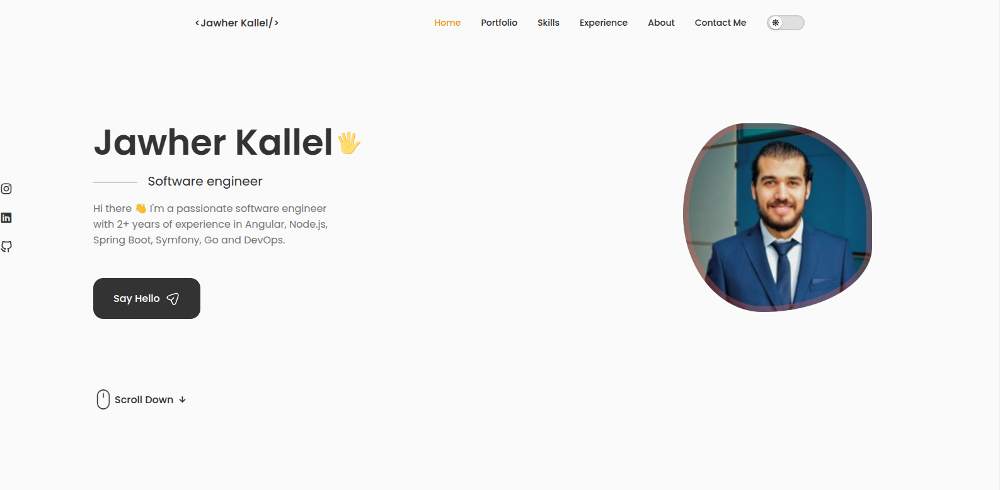

# Portfolio Website - Jawher Kl
<!--

-->
Welcome to the repository for my personal portfolio website! This project showcases my technical skills, projects, and expertise in software engineering. Visit the live site here: 
[Jawher Kl Portfolio](https://jawherkl-github-io.vercel.app)

## 🌟 Features

- **Professional Design**: A sleek and modern design to represent my personal brand.
- **Responsive Layout**: Optimized for all devices, including mobile, tablet, and desktop.
- **Project Showcase**: Highlights my key projects with links to their repositories.
- **Technical Skills**: Displays my expertise in various programming languages and technologies.
- **Contact Section**: Easy-to-use contact form and links to social media profiles.

## 🛠️ Tech Stack

- **Frontend**: ReactJS, JavaScript
- **Styling**: Bootstrap, custom CSS
- **Hosting**: GitHub Pages and vercel

## 📂 Project Structure

```
├── components/       # Reusable React components
├── Images/           # Public images folder
├── src/              # React components and styles
│   ├── assets/       # Images and icons used in the site
│   ├── App.css       # Main CSS component
│   ├── App.jsx       # Main App component
│   ├── index.css     # index css file
│   ├── main.jsx      # Entry point for React
├── index.html        # main index for project
├── README.md         # Repository documentation (you are here!)
```

## 🚀 Getting Started

To run the project locally:

1. **Clone the repository**:
   ```bash
   git clone https://github.com/JawherKl/jawherkl.github.io.git
   ```

2. **Navigate to the project directory**:
   ```bash
   cd jawherkl.github.io
   ```

3. **Install the dependencies**:
   ```bash
   npm install
   ```

4. **Start the development server**:
   ```bash
   npm start
   ```

## 📦 Deployment

The portfolio is hosted using GitHub Pages and Vercel. Any changes pushed to the `main` branch will be reflected automatically.

## 🎯 Future Enhancements

- Add animations for a more interactive user experience.
- Integrate a blog section to share technical articles.
- Implement multilingual support for global accessibility.

## 📝 License

This project is open-source and available under the [MIT License](LICENSE).

## ⭐ Star History

<a href="https://www.star-history.com/?repos=jawherkl%2Fjawherkl.github.io&type=date&legend=top-left">
 <picture>
   <source media="(prefers-color-scheme: dark)" srcset="https://api.star-history.com/chart?repos=jawherkl/jawherkl.github.io&type=date&theme=dark&legend=top-left" />
   <source media="(prefers-color-scheme: light)" srcset="https://api.star-history.com/chart?repos=jawherkl/jawherkl.github.io&type=date&legend=top-left" />
   
 </picture>
</a>

---------------------------------------------------------------------------------------

🚀 **Built with ❤️ by [JawherKl](https://github.com/JawherKl)**
